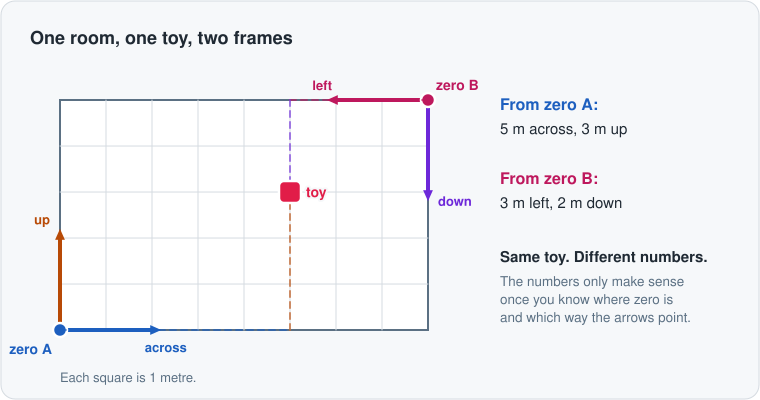
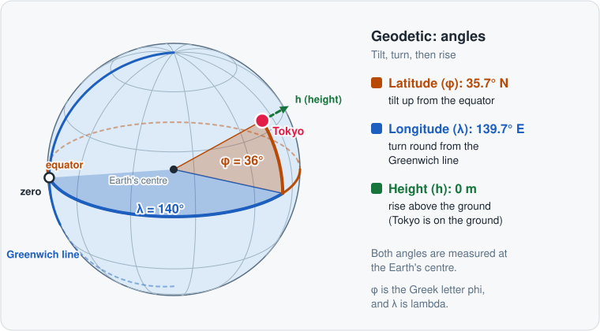
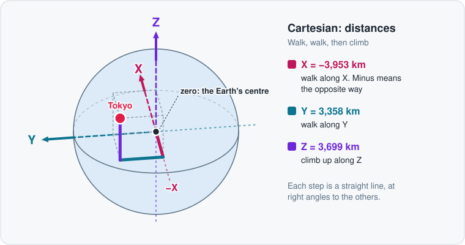

# Introduction to Coordinate Frames

A **coordinate frame** is an agreed way of saying **where something is**.

## The idea in one picture

Imagine a toy on the floor of a room, and you want to tell a friend where it is.

You could say "start in the **bottom-left corner**, walk **5 m across**, then **3 m up**".

Or you could say "start in the **top-right corner**, walk **3 m left**, then **2 m down**".

Both are right. The toy hasn't moved, but the **numbers are different**, because you started from a different corner and walked in different directions.

That's all a coordinate frame is: **where you start, which way you walk, and what you measure in.** Change any of those and the numbers change, even though the thing itself stays put.

## Four questions to ask about any frame

When you meet a new frame, ask:

1. **Where is zero?** The spot where every number is 0.
2. **Which way do the numbers point?** Up, north, towards the North Pole?
3. **What is it attached to?** The spinning Earth, a spot on the ground, a moving vehicle?
4. **What are the numbers?** Distances, or angles?

If you can answer all four, you understand the frame.

## Two big differences between frames

**Geodetic or cartesian? (Angles or distances?)**

A **geodetic** frame uses **angles**, plus a height. It says how far round and how far up the Earth to go, such as "51° north". The name comes from *geodesy*, the science of measuring the Earth's shape. Angles suit a round Earth, because a line of latitude follows the ground.

A **cartesian** frame uses **straight-line distances** along three arrows at right angles, like the corner of a room. It's named after René Descartes, who came up with the idea. Distances are easier to do maths with: you can add them, subtract them and measure straight lines between points.

Both diagrams show the same place, so Tokyo can be written either way:

| | The numbers |
|---|---|
| Geodetic ([LLA](geodetic/global/lla/README.md)) | 35.7° north, 139.7° east, 0 m up |
| Cartesian ([ECEF](cartesian/global/ecef/README.md)) | −3,953 km, 3,358 km, 3,699 km from the Earth's centre |

**Global or local?**

- A **global** frame covers the whole Earth and is shared by everyone.
- A **local** frame starts from a spot you choose, and only works well nearby.

## The frames commonly used in this project

| Frame | Numbers | Where is zero? | Global or local? | Good for |
|---|---|---|---|---|
| [LLA](geodetic/global/lla/README.md) | Two angles and a height | Where the equator meets the Greenwich line | Global | Saying where a place is |
| [ECEF](cartesian/global/ecef/README.md) | Three distances | The centre of the Earth | Global | Satellites, GPS maths and straight lines |
| [NED](cartesian/local/cart-ned/README.md) | Three distances | A spot you choose | Local | Drones, planes and robots moving nearby |

