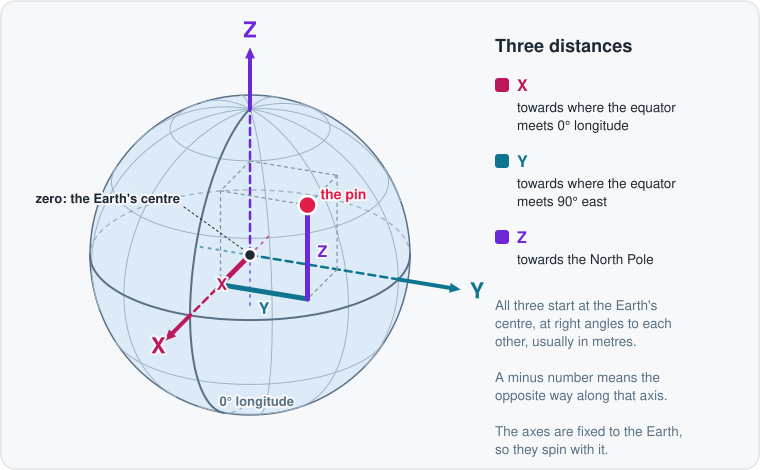

# ECEF: Earth-Centred, Earth-Fixed

**ECEF says where you are using three straight-line distances from the centre of the Earth.**

## ELI5

Imagine pushing three long skewers through the exact middle of an orange, each at a right angle to the other two.

To tell a friend where an ant is, you start **in the middle** and give three instructions:

1. **X:** go this far along the first skewer, towards where the equator meets the Greenwich line.
2. **Y:** then this far along the second, towards where the equator meets 90° east.
3. **Z:** then this far along the third, towards the North Pole.

You end up at the ant. You have to imagine walking through solid rock to get there.

The name tells you the two rules:

- **Earth-Centred:** zero is the centre of the Earth.
- **Earth-Fixed:** the skewers are stuck in the orange. When the Earth spins, they spin with it, so a parked car keeps the same X, Y and Z all day.

A few things to know:

- The numbers are **distances**, usually in metres, so they're big. London is about (3,978,000, −9,000, 4,969,000).
- A **minus** number means the opposite way along that skewer. For example, Z is negative south of the equator.
- **Z is not "up".** It points at the North Pole wherever you are. Going straight up from the ground usually changes all three numbers.

## Where it's used

ECEF is the frame **computers** like, because straight lines are easy to work with.

- **Inside GPS.** Satellite positions, and the maths that works out where your receiver is, are done in an Earth-fixed X, Y, Z frame. The answer is converted to LLA before you see it.
- **Satellites and ground stations.** Tracking satellites, and pointing antennas at them, uses ECEF.
- **Straight-line distances.** The distance between two places is just Pythagoras on their X, Y and Z, measured straight through the Earth.
- **Surveying.** Precise reference points, such as GPS base stations, are often published as X, Y and Z.
- **A stepping stone.** To get from LLA to NED, you usually go through ECEF.

It's **awkward for people**. Nobody can picture where (3978000, −9000, 4969000) is, and it doesn't tell you which way is up, north or east. For that, people use [LLA](../../../geodetic/global/lla/README.md) or [NED](../../local/cart-ned/README.md).

## The diagram

- **Zero** is the black dot at the Earth's centre.
- **X** (pink) comes out where the equator meets the 0° longitude line.
- **Y** (teal) comes out where the equator meets 90° east.
- **Z** (purple) comes out of the North Pole.
- The **thick path** is the pin's three numbers: along X, then along Y, then up Z. The dashed box shows they're all at right angles.

## Try it

Open the [ECEF playground](playground.html) in any web browser. Move the sliders, or tick **spin the Earth** to see why the numbers never change.

**Next:** [NED](../../local/cart-ned/README.md) also uses three distances, but starts from a spot you choose.
