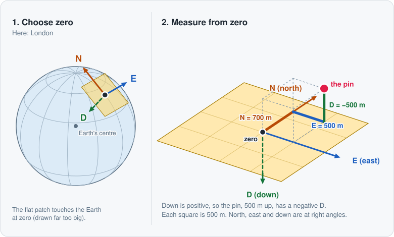

# NED: North, East, Down

**NED says where something is using three straight-line distances from a spot you choose.**

## ELI5

Imagine you're standing in a field and want to tell a friend where a kite is.

You wouldn't start at the centre of the Earth. You'd start **from where you're standing**, and give three instructions:

1. **North (N):** walk this far north.
2. **East (E):** turn right, and walk this far east.
3. **Down (D):** go this far down.

The odd one is **down**. The kite is *up*, so you use a minus number: "down −30 m" means "30 m up". People who work with aircraft chose down because it matches how a pilot sees a plane: **forwards, right wing, floor**.

A few things to know:

- **Zero is wherever you choose**, such as a runway, a launch pad or a drone's take-off spot. The numbers mean nothing until you say where zero is.
- A **minus** number means the opposite way: south, west or up.
- **NED pretends the ground is flat.** Its "ground" is a flat sheet touching the Earth at zero. That's fine close by, but the real Earth curves away underneath: by about 8 cm at 1 km, 8 m at 10 km, and nearly 800 m at 100 km.
- NED is **attached to that spot on the ground**, so it turns with the Earth.

## Where it's used

NED is the frame for **things moving around nearby**.

- **Drones and autopilots.** Many flight controllers keep track of position as north, east and down from where they took off.
- **Aircraft navigation.** Aircraft sensors and flight calculations commonly use north, east and down.
- **Inertial navigation.** Systems that track movement from motion sensors usually work in NED.
- **Flight simulators and robotics.** Anything that needs "how far north, east and up from here" over short distances. Robots often use a close cousin called **ENU**: east, north, **up**.

It's **awkward for long distances**, because of the flat-ground problem, and for sharing locations with anyone who doesn't know your zero. For that, people use [LLA](../../../geodetic/global/lla/README.md) or [ECEF](../../global/ecef/README.md).

## The diagram

**1. Choose zero** (left). Zero is chosen in London. The yellow patch is NED's flat ground, touching the Earth at zero. North points along the ground towards the North Pole, east along the ground to the right, and down into the Earth.

**2. Measure from zero** (right). The same patch, close up.

- **Zero** is the black dot in the middle.
- **N** (orange), **E** (blue) and **D** (green) are at right angles, like the corner of a room.
- The **thick path** is the pin's three numbers: 700 m north, then 500 m east, then 500 m up.
- Because **down** is positive, being 500 m up makes **D = −500**.

## Try it

Open the [NED playground](playground.html) in any web browser. Press **Jump to** to move zero, and notice that N, E and D stay the same while the place changes.

**Next:** [conversions](../../../conversions/README.md) show how to translate between LLA, ECEF and NED.
