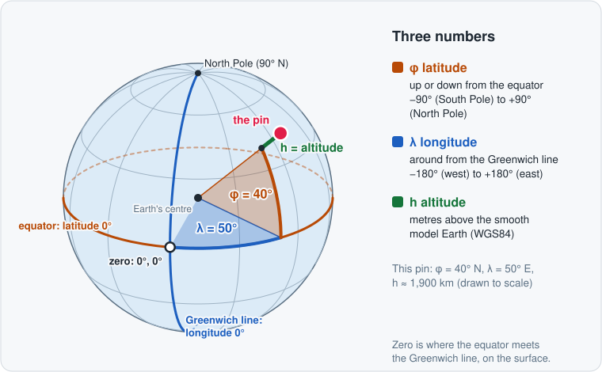

# LLA: latitude, longitude, altitude

**LLA says where you are using two angles and a height.**

## ELI5

Imagine the Earth is an orange, and you want to tell a friend exactly where an ant is standing on it.

You both agree on a starting spot: where the orange's middle line (the **equator**) crosses a line drawn from top to bottom through **Greenwich**, in London. Then you give three instructions:

1. **Longitude (λ):** how far do I turn **around** the orange? East is positive and west is negative.
2. **Latitude (φ):** how far do I go **up or down** from the middle line? North is positive and south is negative.
3. **Altitude (h):** how far **above the peel** is the ant?

So "40° N, 50° E, 300 m" means: turn 50° east, go 40° north, then rise 300 m.

The first two are **angles**, because turning around a round thing is easiest to describe with angles. The third is a plain **distance**.

A few things to know:

- Latitude runs from −90° (the South Pole) to +90° (the North Pole).
- Longitude runs from −180° to +180°. Both ends meet on the opposite side of the world from Greenwich.
- Altitude is measured from a smooth, slightly squashed model of the Earth called **WGS84**. That isn't quite the same as height above sea level, but they're usually within about 100 m.
- LLA is **attached to the Earth**, so a parked car keeps the same LLA all day while the planet spins.

## Where it's used

LLA is the frame **people** use, because it's the easiest to read and share.

- **GPS and phone maps.** When a phone shows your position, it's showing LLA.
- **Sharing a location.** Map pins, photo locations and messages that say "I'm here" all use latitude and longitude.
- **Aircraft and ships.** Airports, waypoints and routes are written as latitude and longitude. Aircraft usually give height above sea level rather than above the WGS84 model.
- **Drone missions.** Waypoints are usually entered as latitude, longitude and altitude.
- **Mapping software and databases.** Most location data is stored as latitude and longitude.

It's **awkward for maths**, such as measuring distances or working out how to move. A degree of longitude gets shorter as you head towards the poles, so you can't treat degrees like metres. For that, people convert to [ECEF](../../../cartesian/global/ecef/README.md) or [NED](../../../cartesian/local/cart-ned/README.md).

## The diagram

- **Zero** is the white dot, where the equator (orange line) meets the Greenwich line (blue line).
- The **blue slice** is longitude: the angle turned around from Greenwich, measured at the Earth's centre.
- The **orange slice** is latitude: the angle up from the equator, also measured at the centre.
- The **green line** is altitude: the height above the surface.

## Try it

Open the [LLA playground](playground.html) in any web browser. Move the sliders and watch the slices and the pin change.

**Next:** [ECEF](../../../cartesian/global/ecef/README.md) describes the same places using three straight distances instead.
