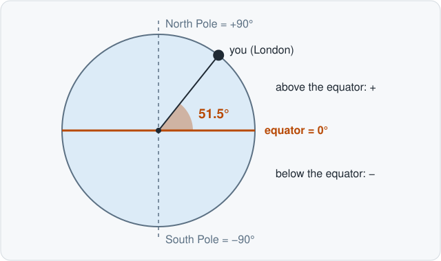
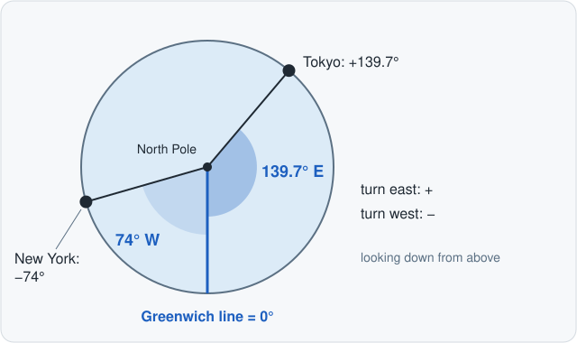
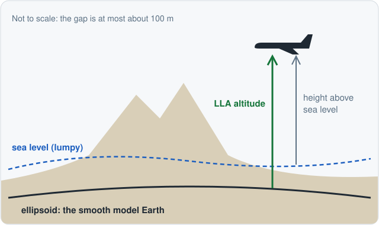
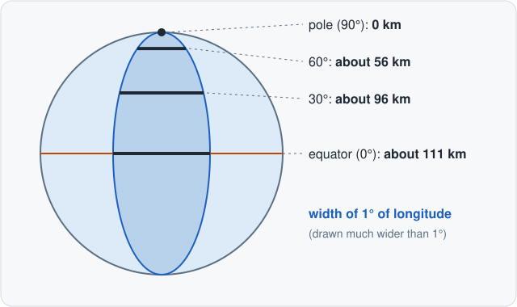
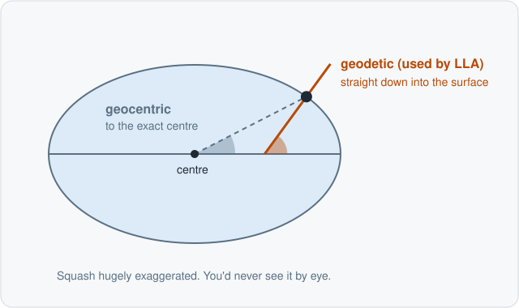

# Understanding Lon, Lat, Altitude (LLA)

**LLA says where you are using two angles and one height.**

## ELI5

Imagine the Earth is an orange, and you want to tell a friend exactly where an ant is standing on it.

You start at a spot you've both agreed on, then give three instructions:

1. <span class="lon">Longitude</span>: how far **around** the orange do I turn?
2. <span class="lat">Latitude</span>: how far **up or down** from its middle do I go?
3. <span class="alt">Altitude</span>: how far **above the peel** is the ant?

That's all LLA is: *around, up or down, and off the surface.* (The name puts latitude first, but you end up in the same place either way.)

## ID card

| Question | Answer |
|---|---|
| **Where is zero?** | Off the west coast of Africa, where the equator crosses the 0° longitude line, on the surface of the model Earth. It's nicknamed *Null Island*. |
| **Which way do the numbers grow?** | <span class="lat">Latitude</span> grows to the north, <span class="lon">longitude</span> to the east, <span class="alt">altitude</span> upwards. |
| **What is it attached to?** | The spinning Earth. A parked car keeps the same LLA all day. |
| **What are the numbers?** | Two **angles** (degrees) and one **distance** (metres). |
| **What range can they have?** | Latitude −90° to +90°. Longitude −180° to +180°. Altitude can be positive or negative. |

!!! tip "Why angles?"
    The Earth is round, so a straight ruler is awkward: "walk 5,000 km" really follows a curve. Angles work naturally on a round thing.

## The three numbers

### <span class="lat">Latitude</span>: how far up or down?

Cut the Earth in half from top to bottom and look at it from the side. Latitude is the angle up from the **equator**.



In maths, latitude is written as the Greek letter <span class="lat">φ</span> ("phi", usually said *fie*).

The equator is 0°, the North Pole is +90° and the South Pole is −90°. "51.5° S" and "−51.5°" mean the same thing.

### <span class="lon">Longitude</span>: how far around?

Now look straight down at the North Pole. Longitude is the angle around from a line that runs through **Greenwich**, in London.



In maths, longitude is written as the Greek letter <span class="lon">λ</span> ("lambda", said *lam-duh*).

East is positive and west is negative. Nature didn't choose Greenwich; people simply agreed on it.

### <span class="alt">Altitude</span>: how far off the surface?

Altitude is a plain distance, straight up. The catch is **what you measure it from**.



On this page, altitude means height above a smooth, slightly squashed model of the Earth called the **WGS84 ellipsoid**. It's the model GPS uses. Maps usually give height above **sea level** instead. Around London, the two differ by roughly 45 m.

## Playground

Things to try:

- Drag the **pin**. Then drag the **globe** itself to look from another side.
- Change <span class="lon">longitude</span> only. Which way does the pin travel?
- Set <span class="lat">latitude</span> to 90, then change longitude. Why doesn't the pin move?
- Read **In plain words** under the plots as you move: it gives the directions from 0°, 0° to the pin.

<iframe class="playground" src="playground.html" title="Interactive LLA playground"></iframe>

<a href="playground.html" target="_blank">Open the playground on its own</a>

## A degree isn't a fixed distance

Longitude lines are like the edges of orange segments: widest at the middle, meeting at the poles.



So one degree of <span class="lon">longitude</span> gets **narrower** towards the poles. One degree of <span class="lat">latitude</span> stays close to 111 km everywhere.

| Decimal places | Example (latitude) | Roughly how precise |
|---|---|---|
| 0 | 51° | 111 km |
| 1 | 51.5° | 11 km |
| 2 | 51.48° | 1.1 km |
| 3 | 51.478° | 110 m |
| 4 | 51.4779° | 11 m |
| 5 | 51.47788° | 1 m |

## Some real places

| Place | Latitude | Longitude | In words |
|---|---|---|---|
| Royal Observatory, Greenwich | +51.4779° | −0.0015° | North of the equator, a hair west of zero |
| Sydney Opera House | −33.8568° | +151.2153° | South and east |
| Quito, Ecuador | −0.1807° | −78.4678° | Just south of the equator, and west |
| North Pole | +90° | any | Every longitude line meets here |

## Common traps

??? warning "Is it lat, lon or lon, lat?"
    People usually say latitude first. Some software, such as GeoJSON, puts **longitude first**. Swap them by accident and London ends up in the Indian Ocean, off Somalia.

??? warning "Degrees or radians?"
    People use degrees. Python's `math.sin` and `math.cos` expect **radians**, so convert first with `math.radians(...)`.

??? warning "You can't treat degrees like metres"
    A 1° step east and a 1° step north are different distances almost everywhere, so you can't just use Pythagoras on latitude and longitude.

??? warning "The number jumps at ±180°"
    Step east from +179.9° by 0.2° and you land on −179.9°. You barely moved; the numbering just wrapped around.

??? warning "Longitude means nothing at the poles"
    All the longitude lines meet there, so every longitude describes the same spot.

??? warning "Height above what?"
    Height above the ellipsoid (typical of raw GPS) and height above sea level (typical of maps) can differ by up to about 100 m. Always check which one you have.

??? note "Why isn't GPS exactly 0° at the Greenwich line?"
    The old line marked on the ground and the modern 0° line are about 100 m apart. The modern one is defined by a worldwide model rather than by one telescope.

## When would I use LLA?

- **Good for:** saying where something is, GPS, maps, and sharing a location with people.
- **Awkward for:** measuring distances, adding movements together, or doing physics. That's when people switch to [ECEF](../../../cartesian/global/ecef/index.md) or [NED](../../../cartesian/local/cart-ned/index.md).

## One sentence to remember

> LLA is **around, up or down, and off the surface**: two angles and a height, attached to the spinning Earth.

??? abstract "Optional: a little deeper"
    **Why is it called *geodetic*?** The Earth is slightly squashed: its surface is about 21 km further from the centre at the equator than at the poles. So there are two possible "up from the equator" angles.

    

    - **Geodetic latitude** uses the line that goes *straight down into the model's surface*. This is the one LLA uses.
    - **Geocentric latitude** uses the line to the *exact centre*.

    The difference is never more than about 0.19°, but that's around 21 km on the ground. The diagram exaggerates the squash enormously.

    **The shrinking degree, in Python.** This simple version treats the Earth as a perfect ball, so it's very slightly off:

    ```python
    import math

    def km_per_degree_of_longitude(latitude_degrees):
        return 111.32 * math.cos(math.radians(latitude_degrees))

    print(km_per_degree_of_longitude(0))   # about 111 km
    print(km_per_degree_of_longitude(60))  # about 56 km
    ```
