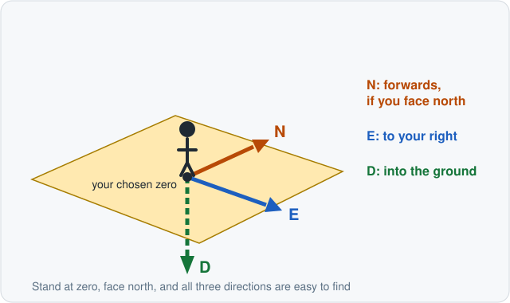
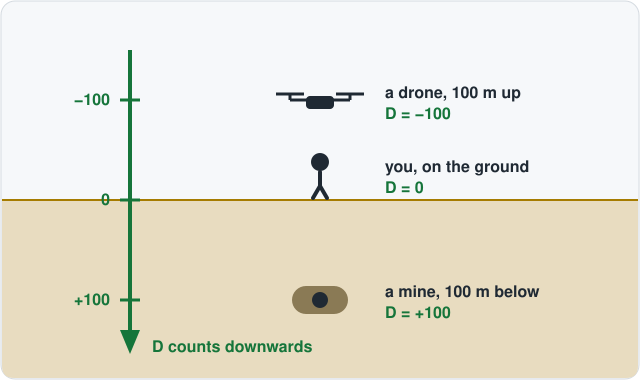
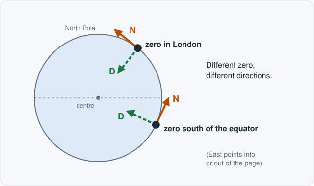
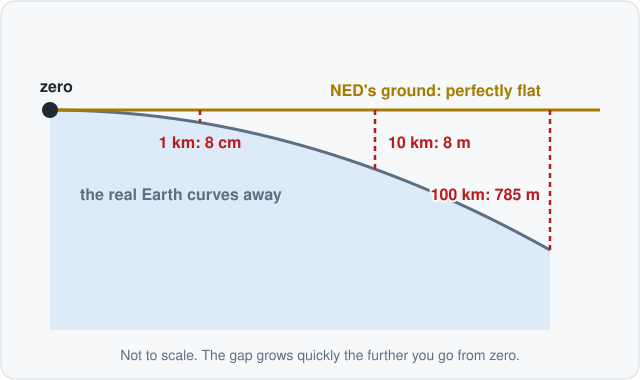

# Understanding North, East, Down (NED)

**NED says where something is, as three straight-line distances from a spot you choose.**

## ELI5

Imagine you're standing in a field and want to tell a friend where a kite is.

You wouldn't start at the centre of the Earth. You'd start **from where you're standing**, and give three instructions:

1. North: walk this far north.
2. East: turn right, and walk this far east.
3. Down: go this far down.

The odd one is **down**. The kite is *up*, so you'd say a minus number: "down −30 metres" means "up 30 metres".

That's all NED is: *north, east, down, starting from here.*

## ID card

| Question | Answer |
|---|---|
| **Where is zero?** | Anywhere you like. You choose a spot, such as a launch pad or a runway. |
| **Which way do the axes point?** | N points north, E points east, and D points straight down into the ground. |
| **What is it attached to?** | That spot on the ground, so it's carried round as the Earth spins. |
| **What are the numbers?** | Three **distances**, usually in metres. |
| **What range can they have?** | Anything, positive or negative. It works best close to zero. |

!!! tip "Why start from here?"
    Near you, the world looks flat. "300 m north, 100 m up" is easy to picture. Distances from the Earth's centre aren't.

## The three directions

The three directions are at right angles, like the corner of a room. A **minus** means the opposite way: south, west or up.

## Why is down positive?

It looks backwards, but it's just a choice that people who work with aircraft made. North, east, down matches how a pilot sees a plane: **forwards, right wing, floor**.

It also means going deeper makes D bigger, like the depth of water.

## Zero is everything

"300 m north, 100 m east" means nothing until you say **from where**. Move zero, and:

- the same numbers describe a **different place**
- north, east and down point in **different directions**

## Playground

Things to try:

- Move down below zero, then above it. Which way does the pin go?
- Press **Tokyo**, then **Rome**. The numbers stay the same, but the pin is in a different country.
- Look at the D arrow on the globe. Wherever you put zero, it heads for the Earth's centre, or very close to it.
- Make the **box** completely flat. Which number did you set to 0?
- Tick **spin the Earth** and watch the numbers.

<iframe class="playground" src="playground.html" title="Interactive NED playground"></iframe>

<a href="playground.html" target="_blank">Open the playground on its own</a>

## It pretends the ground is flat

NED's ground is a perfectly flat sheet touching the Earth at zero. The real Earth curves away underneath it.

| Distance from zero | Gap between flat and round |
|---|---|
| 1 km | about 8 cm |
| 10 km | about 8 m |
| 100 km | about 785 m |

So 100 km from zero, something with D = 0 is really about 785 m above the ground. NED is made for **short distances**.

## How is this different from LLA and ECEF?

| | [LLA](../../../geodetic/global/lla/index.md) | [ECEF](../../global/ecef/index.md) | NED |
|---|---|---|---|
| **Numbers** | Two angles and a height | Three distances | Three distances |
| **Zero** | On the surface, at 0°, 0° | The Earth's centre | A spot you choose |
| **Covers** | The whole Earth | The whole Earth | The area near zero |
| **Global or local?** | Global | Global | Local |
| **Good for** | Saying where a place is | Satellites and straight lines | Moving around nearby |

NED is the first **local** frame here. LLA and ECEF are shared by everyone, but every NED frame belongs to its own zero.

## Some examples

From whatever spot you choose as zero:

| In words | N | E | D |
|---|---|---|---|
| Standing at zero | 0 | 0 | 0 |
| 200 m north | 200 | 0 | 0 |
| 50 m west | 0 | −50 | 0 |
| A drone 120 m overhead | 0 | 0 | −120 |
| A tunnel 30 m below | 0 | 0 | 30 |
| 1 km south, 400 m east, 10 m up | −1,000 | 400 | −10 |

## Common traps

??? warning "Up is negative"
    A drone at 100 m has D = **−100**. Forget the minus sign and you've put it underground.

??? warning "Where is zero?"
    NED numbers are useless without knowing zero. Always write down where it is.

??? warning "NED or ENU?"
    **ENU** means East, North, **Up**. It's the same idea with the order swapped and up positive. Check which one you've been given.

??? warning "Fixed zero or moving zero?"
    On this page, zero stays put on the ground. Some people say "NED" for directions that travel along **with a vehicle**. Check which one they mean.

??? warning "North is not the nose"
    NED's north is always north. If a plane turns, its nose points somewhere else, but N doesn't move. Directions that turn with the plane are called a **body frame**.

??? warning "Which north?"
    NED uses **true north**, towards the North Pole. A compass points to **magnetic north**, which is slightly different in most places.

??? warning "D is not exactly your height above the ground"
    D is measured from zero's flat sheet. On a hillside, or far from zero, the ground under you isn't at D = 0.

## When would I use NED?

- **Good for:** drones, aircraft, boats and robots moving around near a known spot.
- **Awkward for:** long distances, or sharing a location with someone who doesn't know your zero.

## One sentence to remember

> NED is **north, east and down, starting from a spot you choose**. Up is negative.
